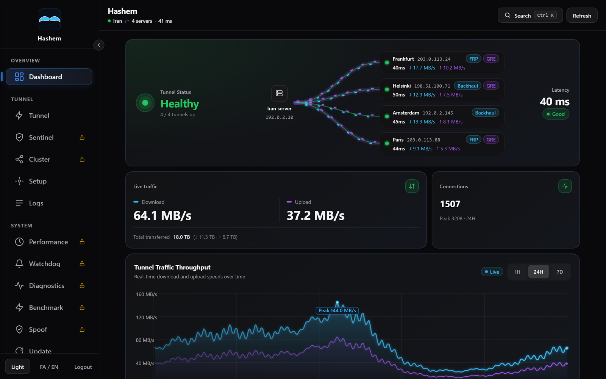

<div align="center" dir="rtl">

# پنل هاشم

**تونل از سرور ایران به سرورهای خارج؛ ساخت، پایش و تعمیر از یک پنل وب.**

کاربران به IP عمومی سرور ایران وصل می‌شوند و ترافیکشان از راه GRE، FRP، Backhaul، Xray، SSH یا تونل اسپوف به سرویس‌های سرور خارج می‌رسد؛ با بررسی سلامت، جابه‌جایی خودکار و آپدیتی که می‌شود برگرداند.

[](https://github.com/pdnczone/hashem-panel/releases/latest)
[](https://github.com/pdnczone/hashem-panel/releases)
[](https://github.com/pdnczone/hashem-panel/actions/workflows/ci.yml)
[](#نیازمندیها)
[](LICENSE)

[English](README.md) · فارسی · [وب‌سایت](https://pdnczone.ir) · [تلگرام](https://t.me/pdnczone) · [یوتیوب](https://youtube.com/@pdnczone)



</div>

<div dir="rtl">

---

## چرا هاشم

- **یک نصب، برای هر دو طرف.** همین پنل روی سرور ایران و روی همه‌ی سرورهای خارج نصب می‌شود. سرور ایران را تنظیم می‌کنید، یک باندل کپی می‌کنید و روی سرور خارج می‌چسبانید.
- **هر راهی که باز باشد.** شش موتور تونل و چهار پوشش GRE، به‌همراه تست مسیری که *پیش از* ساختن تونل می‌گوید کدام رد می‌شود.
- **خودش سرپا می‌ماند.** بررسی سلامت هر لینک، تعویض حاملی که اگر جواب ندهد خودش برمی‌گردد، واچ‌داگ، و Autopilot که تونل قطع را به حاملی می‌برد که کار می‌کند.
- **چند سرور، یک جا.** یک پنل مرکزی همه‌ی سرورها را مدیریت می‌کند؛ نود فقط یک هسته‌ی کوچک لازم دارد، نه پنل کامل.

## چطور کار می‌کند

**سرور ایران** پورت‌های عمومی‌ای را دارد که کاربران به آن وصل می‌شوند. روی هر **سرور خارج** سرویس‌های شما (مثلاً پنل Xray) اجرا می‌شود و با یک تونل به سرور ایران وصل است. سرورهای خارج بعدی از تب **Setup** اضافه می‌شوند، یا با کلاستر چند تا پشت یک پورت قرار می‌گیرند.

## موتورهای تونل

| موتور | از چه راهی | کی انتخابش کنید |
| --- | --- | --- |
| **GRE + FRP** | FRP روی لینک GRE (tcp، kcp، quic، websocket، wss) | پیش‌فرض؛ بیشترین امکانات و رایگان |
| **Backhaul** | با یا بدون GRE (tcpmux، ws، wss، udp و …) | وقتی GRE بسته است یا ترنسپورت‌های Backhaul را می‌خواهید |
| **Xray** | VLESS با Reality، XHTTP، gRPC، mKCP یا CDN | وقتی مسیر باید شبیه HTTPS معمولی باشد |
| **باقر** | FRP داخل چند اتصال SSH | وقتی فقط SSH رد می‌شود |
| **اسپوف** | پایپ با IP مبدأ جعلی و WireGuard روی آن | وقتی فایروال فقط IPهای لیست سفید را راه می‌دهد |

لینک GRE چهار پوشش دارد: **مستقیم** (پروتکل ۴۷)، **WSS** (TLS روی پورت وب)، **6to4** (پروتکل ۴۱) و **4in6** (روی IPv6). مطمئن نیستید چه چیزی رد می‌شود؟ **تست مسیر** پیش از انتخاب، همه‌ی ترنسپورت‌ها را بین دو سرور امتحان می‌کند. جزئیات: [انتخاب تونل](docs/ENGINES.md).

## امکانات

**پایداری**
- **یک مدل سلامت** برای داشبورد، هدر، نقشه‌ی نودها و همه‌ی کارت‌ها، با تأخیر هر لینک و هشدار وبهوک یا تلگرام وقتی وضعیت تونلی عوض شود.
- **تعویض حامل** از هر کدام از دو سرور: هر دو طرف با هم عوض می‌شوند و اگر حامل تازه تا ۴۵ ثانیه وصل نشود، هر دو برمی‌گردند.
- **Autopilot** (Pro): تونلی که قطع بماند تست مسیر می‌شود و روی هر دو سرور به سریع‌ترین حاملی می‌رود که رد می‌شود، در محدوده‌ای که شما تعیین می‌کنید. [راهنما](docs/AUTOPILOT.fa.md)
- **واچ‌داگ** که فقط چیزی را ری‌استارت می‌کند که واقعاً خراب است و به تونل سالم دست نمی‌زند.

**چند سرور**
- **نودها:** افزودن سرور با یک خط یا SSH، باز کردن صفحه‌های هر سرور از مرکز، ساختن تونل بین دو سرور از یک صفحه، و به‌روزرسانی، پشتیبان‌گیری و هشدار همه در یک جا. [راهنما](docs/NODES.fa.md)
- **هسته‌ی نود:** نود می‌تواند `hashem-node` را اجرا کند، همان برنامه بدون صفحه‌ی وب؛ هر وقت خواستید بین هسته و پنل کامل جابه‌جا شوید.
- **نقشه‌ی نودها:** هر سرور در ستون خودش و تونل‌ها به‌شکل خط به رنگ سلامتشان، با حامل هر تونل و CPU، RAM، دیسک و ترافیک زنده.
- **کلاستر:** چند سرور خارج پشت یک پورت ایران (failover، balance، sticky، کمترین تأخیر، کمترین اتصال)، پشتیبانی سرورهای ایران از هم، سرور خارجی که چند هاب ایران را سرویس می‌دهد، و جابه‌جایی DNS. [راهنما](docs/CLUSTER.fa.md)

**دید و تحلیل**
- **تست مسیر و بنچمارک:** همه‌ی ترنسپورت‌ها و حامل‌ها اندازه‌گیری و امتیازدهی می‌شوند و بهترین با یک کلیک اعمال می‌شود؛ از صفحه‌ی نودها بین هر دو سروری هم.
- **عیب‌یابی** (Pro): دسترسی‌پذیری که پورت فیلترشده را از IP فیلترشده جدا می‌کند، اختلاف ساعت دو سرور، مسیر هاپ‌به‌هاپ، تست پایداری با نمودار، تست همه‌ی پورت‌های فوروارد و تاریخچه‌ی زمان‌بندی‌شده.
- **مشتری‌ها** (Pro): فروش تونل با پلن روز، حجم و سرعت؛ با تمام شدن پلن، تونل‌های مشتری قطع می‌شوند. [راهنما](docs/CUSTOMERS.fa.md)

**نگهداری و امنیت**
- **آپدیت قابل برگشت:** کانال stable و dev، دانلود با تأیید SHA-256، برگشت خودکار اگر نسخه‌ی تازه بالا نیاید، و رساندن FRP به نسخه‌ی ثابت‌شده هنگام آپدیت.
- **بکاپ رمزنگاری‌شده**، تنظیم کارایی متناسب با RAM سرور و تعمیر سریع.
- **پنل امن:** رمز argon2id، محافظت CSRF، ورود دومرحله‌ای اختیاری، لاگ ممیزی، و ترمینال وب که پیش‌فرض خاموش است.
- **همه‌چیز از SSH هم:** دستور `hashem` یک برنامه‌ی ترمینالی با همان منوهای پنل باز می‌کند.

## تازه‌های نسخه‌ی ۳.۱.۲

- **هسته‌ی نود و نقشه‌ی نودها:** نودها دیگر پنل کامل لازم ندارند و صفحه‌ی نودها کل شبکه را با سلامت زنده نشان می‌دهد.
- **تست بین سرورها:** تست مسیر و بنچمارک تونل بین هر دو سرور، بدون کپی کردن کد.
- **تب Autopilot:** تونلی که قطع بماند خودش به حاملی می‌رود که رد می‌شود.
- **عیب‌یابی عمیق‌تر:** دسترسی‌پذیری، ساعت، مسیر، پایداری، پورت‌ها و تاریخچه.
- **ارتقای FRP همراه هاشم:** `hashem update` حالا FRP قدیمی را به ۰.۷۱.۰ می‌رساند؛ اول همه‌ی کانفیگ‌ها را چک می‌کند و اگر سرویسی بالا نیاید برمی‌گردد.
- **رفع مشکلات یک هاب پرترافیک** (بیش از ۲۰ هزار اتصال): لاگ‌ها دیگر دیسک را پر نمی‌کنند، frps و frpc سقف حافظه دارند و واچ‌داگ به تونل سالم دست نمی‌زند.
- **کلاستر:** سرور خارج حالا می‌تواند با FRP به هاب ایران دوم وصل شود ([#14](https://github.com/pdnczone/hashem-panel/issues/14)).
- طراحی تازه‌ی پنل: هدر و صفحه‌های تنظیمات، آپدیت، کارایی و بنچمارک.

فهرست کامل: [CHANGELOG.md](CHANGELOG.md).

## نصب سریع

روی **هر دو** سرور اجرا کنید:

</div>

```bash
bash <(curl -fsSL https://raw.githubusercontent.com/pdnczone/hashem-panel/main/install.sh)
```

<div dir="rtl">

۱. **سرور ایران:** گزینه‌ی `1`؛ تونل و پورت‌ها را انتخاب کنید و باندلی را که چاپ می‌شود (`hsh1_…`) کپی کنید.
۲. **سرور خارج:** گزینه‌ی `2` و باندل را بچسبانید.
۳. **پنل را باز کنید** با آدرسی که آخر نصب چاپ می‌شود (`http://<server-ip>:7777/<secret>`).

آدرس را گم کردید؟ `hashem show-panel-url`. رمز تازه: `hashem reset-password`. پنل مرکزی دارید؟ صفحه‌ی **نودها** یک خط می‌دهد که هسته‌ی نود را روی سرور تازه نصب و به مرکز وصل می‌کند. خواندن نصاب پیش از اجرا یا ثابت کردن نسخه‌ی آن: [نصب امن](docs/OPERATIONS.md#installing-safely).

> [!IMPORTANT]
> پنل به‌صورت پیش‌فرض روی HTTP و یک مسیر تصادفی بلند است. پیش از باز کردن آن به اینترنت، با `hashem tls issue <دامنه>` یا یک reverse proxy روی آن TLS بگذارید ([استقرار امن](docs/DEPLOYMENT.md)).

## خط فرمان

| دستور | کارش |
| --- | --- |
| `hashem` | برنامه‌ی ترمینالی با همان منوهای پنل |
| `hashem status` · `hashem logs` · `hashem restart` | وضعیت تونل، لاگ‌ها، ری‌استارت |
| `hashem doctor [fix]` | تأخیر، جیتر، MTU و سرعت؛ `fix` تعمیر سریع را اجرا می‌کند |
| `hashem carrier status\|next` · `hashem autopilot on\|off` | جابه‌جایی حامل و Autopilot |
| `hashem update` · `hashem update-channel stable\|dev` | آپدیت اسکریپت، پنل و FRP |
| `hashem backup now` · `hashem backup restore <file>` | بکاپ رمزنگاری‌شده |
| `hashem tls issue <domain>` · `hashem settings` | HTTPS و تنظیمات پنل |
| `hashem node-join <code>` · `hashem panel status\|install\|remove` | پیوستن به مرکز؛ جابه‌جایی بین هسته‌ی نود و پنل |
| `hashem join-hub --bundle …` · `hashem cluster status` | کلاستر: سرویس به چند هاب ایران، پول‌ها |

`hashem --help` همه‌ی دستورها را نشان می‌دهد. مرجع: [کار روزانه](docs/OPERATIONS.fa.md).

## نیازمندی‌ها

- لینوکس با systemd، معماری `amd64` یا `arm64` (توسعه روی Ubuntu)، و دسترسی root روی هر دو سرور. نصاب بسته‌های لازم را خودش نصب می‌کند.
- دسترسی هر دو سرور به GitHub برای نصب و آپدیت.
- بین دو سرور، هر چیزی که تونلتان لازم دارد باز باشد:

| تونل یا پوشش | باز باشد |
| --- | --- |
| GRE مستقیم · 4in6 | پروتکل IP شماره‌ی ۴۷ (روی IPv4 · روی IPv6) |
| 6to4 | پروتکل IP شماره‌ی ۴۱ |
| پوشش WSS | TCP `8443` (پیش‌فرض) |
| FRP · Backhaul · Xray | پورت کنترلی که انتخاب می‌کنید (برای kcp، quic و udp روی UDP هم) |
| پنل | TCP `7777`، یا `7443` بعد از فعال شدن HTTPS |

## Hashem Pro

GRE + FRP، پنل و آپدیت‌ها رایگان‌اند. **لایسنس Pro** راه‌اندازی Backhaul، Xray، باقر، اسپوف، محدودیت‌ها، کلاستر، Autopilot، تست مسیر، عیب‌یابی، تنظیمات کارایی، واچ‌داگ و بنچمارک را باز می‌کند. هر لایسنس Pro همه‌ی امکانات Pro را باز می‌کند، حتی آن‌هایی که بعداً اضافه می‌شوند، و تونل‌ها و تنظیماتی که کار می‌کنند بدون لایسنس هم کار می‌کنند. خرید لایسنس: [pdnczone.ir](https://pdnczone.ir)

## مستندات

| | |
| --- | --- |
| **شروع** | [انتخاب تونل](docs/ENGINES.md) · [رفع اشکال و کار روزانه](docs/OPERATIONS.fa.md) · [استقرار امن](docs/DEPLOYMENT.md) |
| **راهنماها** | [نودها](docs/NODES.fa.md) · [Autopilot](docs/AUTOPILOT.fa.md) · [کلاستر](docs/CLUSTER.fa.md) · [آموزش کلاستر](docs/CLUSTER_TUTORIAL.fa.md) · [مشتری‌ها](docs/CUSTOMERS.fa.md) · [تونل Xray](docs/XRAY_TUNNEL.fa.md) · [IPv6](docs/IPV6.fa.md) · [ترنسپورت‌های FRP](docs/FRP_TUNNELS_GUIDE.md) |
| **مرجع** | [مرجع کامل (انگلیسی)](docs/OPERATIONS.md) · [API](docs/API.md) · [کدهای خطا](docs/ERROR_CODES.md) · [CHANGELOG](CHANGELOG.md) |
| **پروژه** | [مشارکت](CONTRIBUTING.md) · [توسعه](docs/dev/DEVELOPMENT.md) · [امنیت](SECURITY.md) |

## مشارکت و مجوز

Issue و Pull Request خوش‌آمد است؛ [CONTRIBUTING.md](CONTRIBUTING.md) را بخوانید و از شاخه‌ی `dev` شروع کنید. مشکل امنیتی را خصوصی گزارش کنید ([SECURITY.md](SECURITY.md)).

هاشم ساخته‌ی **[pdnczone](https://github.com/pdnczone)** است و تحت مجوز [AGPL-3.0](LICENSE) منتشر می‌شود: اگر نسخه‌ی تغییریافته را به‌صورت سرویس شبکه اجرا کنید، باید تغییراتتان را با همین مجوز منتشر کنید. امکانات Pro به لایسنس از سازنده نیاز دارند.

</div>
