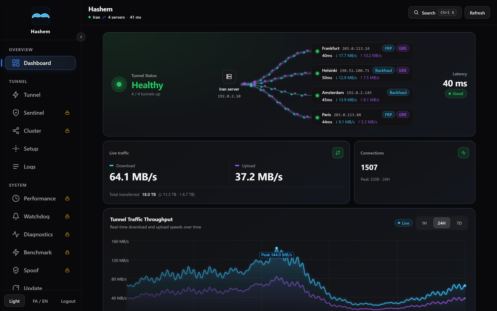

<div align="center" dir="rtl">

# پنل هاشم

**تونل بین سرور ایران و سرورهای خارج، با مدیریت از یک پنل وب.**

کاربران به IP عمومی سرور ایران وصل می‌شوند و ترافیکشان از راه GRE، FRP، Backhaul، Xray، SSH یا تونل اسپوف به سرویس‌های سرور خارج می‌رسد؛ با بررسی سلامت، جابه‌جایی خودکار و آپدیت امن.

[](https://github.com/pdnczone/hashem-panel/releases)
[](https://github.com/pdnczone/hashem-panel/actions/workflows/ci.yml)
[](LICENSE)

[English](README.md) · فارسی · [وب‌سایت](https://pdnczone.ir) · [تلگرام](https://t.me/pdnczone) · [یوتیوب](https://youtube.com/@pdnczone)



</div>

<div dir="rtl">

## چطور کار می‌کند

**سرور ایران** پورت‌های عمومی‌ای را دارد که کاربران به آن وصل می‌شوند. روی هر **سرور خارج** سرویس‌های شما (مثلاً پنل Xray) اجرا می‌شود و با یک تونل به سرور ایران وصل است. همین پنل روی هر دو سرور نصب می‌شود: سرور ایران را تنظیم می‌کنید، یک **باندل** کپی می‌کنید و روی سرور خارج می‌چسبانید.

## تونل‌ها

| تونل | از چه راهی | کی انتخابش کنید |
| --- | --- | --- |
| **GRE + FRP** | FRP روی لینک GRE | پیش‌فرض؛ بیشترین امکانات و رایگان |
| **Backhaul** | با یا بدون GRE | وقتی GRE بسته است یا ترنسپورت‌های Backhaul را می‌خواهید |
| **Xray** | VLESS با Reality، XHTTP، gRPC، mKCP یا CDN | وقتی مسیر باید شبیه HTTPS معمولی باشد |
| **باقر** | FRP داخل چند اتصال SSH | وقتی فقط SSH رد می‌شود |
| **اسپوف** | پایپ با IP مبدأ جعلی و WireGuard روی آن | وقتی فایروال فقط IPهای لیست سفید را رد می‌کند |

لینک GRE چهار پوشش دارد: **مستقیم** (پروتکل ۴۷)، **WSS** (TLS روی پورت وب)، **6to4** (پروتکل ۴۱) و **4in6** (روی IPv6). مطمئن نیستید چه چیزی رد می‌شود؟ **تست مسیر** در تب Benchmark پیش از ساختن تونل همه را بین دو سرور امتحان می‌کند. جزئیات: [docs/ENGINES.md](docs/ENGINES.md).

## امکانات

- **یک مدل سلامت** برای داشبورد، نقشه و همه‌ی کارت‌ها، با تأخیر هر لینک و هشدار وبهوک یا تلگرام وقتی وضعیت تونلی عوض شود.
- **تعویض حامل هر تونل** از هر کدام از دو سرور؛ هر دو عوض می‌شوند و اگر حامل تازه تا ۴۵ ثانیه وصل نشود، هر دو برمی‌گردند.
- **کلاستر:** چند سرور خارج پشت یک پورت ایران، پشتیبانی سرورهای ایران از هم و جابه‌جایی DNS. [راهنما](docs/CLUSTER.fa.md)
- **نودها:** همه سرورها از یک پنل: افزودن با یک خط یا SSH، باز کردن صفحه‌های هر سرور از مرکز، ساختن تانل بین دو سرور از یک صفحه، به‌روزرسانی و پشتیبان‌گیری و هشدارهای همه در یک جا. [راهنما](docs/NODES.fa.md)
- **مشتری‌ها (Pro):** فروش تانل: هر مشتری سرورهای خارج خودش را می‌آورد، شما پلن (روز، حجم، سرعت) را تعیین می‌کنید و با تمام شدن آن تانل‌هایش قطع می‌شود. [راهنما](docs/CUSTOMERS.fa.md)
- **واچ‌داگ، بکاپ رمزنگاری‌شده و عیب‌یابی** (`hashem doctor`) با تعمیر سریع.
- **آپدیت قابل برگشت:** کانال stable و dev، تأیید SHA-256 و برگشت خودکار اگر نسخه‌ی تازه بالا نیاید.
- **پنل امن:** رمز argon2id، CSRF، ورود دومرحله‌ای اختیاری و لاگ ممیزی؛ ترمینال وب پیش‌فرض خاموش است.
- **همه‌چیز از SSH هم:** دستور `hashem` یک برنامه‌ی ترمینالی با همان منوهای پنل باز می‌کند.

## نصب سریع

روی **هر دو** سرور اجرا کنید:

```bash
bash <(curl -fsSL https://raw.githubusercontent.com/pdnczone/hashem-panel/main/install.sh)
```

۱. **سرور ایران:** گزینه‌ی `1`؛ تونل و پورت‌ها را انتخاب کنید و باندلی را که چاپ می‌شود (`hsh1_…`) کپی کنید.
۲. **سرور خارج:** گزینه‌ی `2` و باندل را بچسبانید.
۳. **پنل را باز کنید** با آدرسی که آخر نصب چاپ می‌شود. آدرس را گم کردید؟ `hashem show-panel-url`؛ رمز تازه: `hashem reset-password`.

سرورهای خارج بعدی از تب **Setup** پنل اضافه می‌شوند. خواندن نصاب پیش از اجرا یا ثابت کردن نسخه‌ی آن: [نصب امن](docs/OPERATIONS.md#installing-safely).

> [!IMPORTANT]
> پنل به‌صورت پیش‌فرض روی HTTP و یک مسیر تصادفی بلند است. پیش از باز کردن آن به اینترنت، با `hashem tls issue <دامنه>` یا یک reverse proxy روی آن TLS بگذارید ([docs/DEPLOYMENT.md](docs/DEPLOYMENT.md)).

## نیازمندی‌ها

- لینوکس با systemd، معماری `amd64` یا `arm64` (توسعه روی Ubuntu)، و دسترسی root روی هر دو سرور. نصاب بسته‌های لازم را خودش نصب می‌کند.
- دسترسی هر دو سرور به GitHub برای نصب و آپدیت.
- بین دو سرور، هر چیزی که تونلتان لازم دارد:

| تونل یا پوشش | باز باشد |
| --- | --- |
| GRE مستقیم · 4in6 | پروتکل IP شماره‌ی ۴۷ (روی IPv4 · روی IPv6) |
| 6to4 | پروتکل IP شماره‌ی ۴۱ |
| پوشش WSS | TCP `8443` (پیش‌فرض) |
| FRP · Backhaul · Xray | پورت کنترلی که انتخاب می‌کنید (برای kcp، quic و udp روی UDP هم) |
| پنل | TCP `7777`، یا `7443` بعد از فعال شدن HTTPS |

## Hashem Pro

GRE + FRP، پنل و آپدیت‌ها رایگان‌اند. **لایسنس Pro** راه‌اندازی Backhaul، Xray، باقر، اسپوف، محدودیت‌ها، کلاستر، تست مسیر، عیب‌یابی، تنظیمات کارایی، واچ‌داگ و بنچمارک را باز می‌کند. هر لایسنس Pro همه‌ی امکانات Pro را باز می‌کند، حتی آن‌هایی که بعداً اضافه می‌شوند، و تونل‌ها و تنظیماتی که کار می‌کنند بدون لایسنس هم کار می‌کنند. [pdnczone.ir](https://pdnczone.ir)

## مستندات

| | |
| --- | --- |
| **شروع** | [انتخاب تونل](docs/ENGINES.md) · [رفع اشکال و کار روزانه](docs/OPERATIONS.fa.md) · [استقرار امن](docs/DEPLOYMENT.md) |
| **راهنماها** | [IPv6](docs/IPV6.fa.md) · [تونل Xray](docs/XRAY_TUNNEL.fa.md) · [کلاستر](docs/CLUSTER.fa.md) · [آموزش کلاستر](docs/CLUSTER_TUTORIAL.fa.md) · [نودها](docs/NODES.fa.md) · [مشتری‌ها](docs/CUSTOMERS.fa.md) · [ترنسپورت‌های FRP](docs/FRP_TUNNELS_GUIDE.md) |
| **مرجع** | [مرجع کامل (انگلیسی)](docs/OPERATIONS.md) · [API](docs/API.md) · [کدهای خطا](docs/ERROR_CODES.md) · [CHANGELOG](CHANGELOG.md) |
| **پروژه** | [مشارکت](CONTRIBUTING.md) · [توسعه](docs/dev/DEVELOPMENT.md) · [امنیت](SECURITY.md) |

## مشارکت و مجوز

Issue و Pull Request خوش‌آمد است؛ [CONTRIBUTING.md](CONTRIBUTING.md) را بخوانید و از شاخه‌ی `dev` شروع کنید. مشکل امنیتی را خصوصی گزارش کنید ([SECURITY.md](SECURITY.md)).

تحت مجوز [AGPL-3.0](LICENSE): اگر نسخه‌ی تغییریافته را به‌صورت سرویس شبکه اجرا کنید، باید تغییراتتان را با همین مجوز منتشر کنید. امکانات Pro به لایسنس از سازنده نیاز دارند.

</div>
