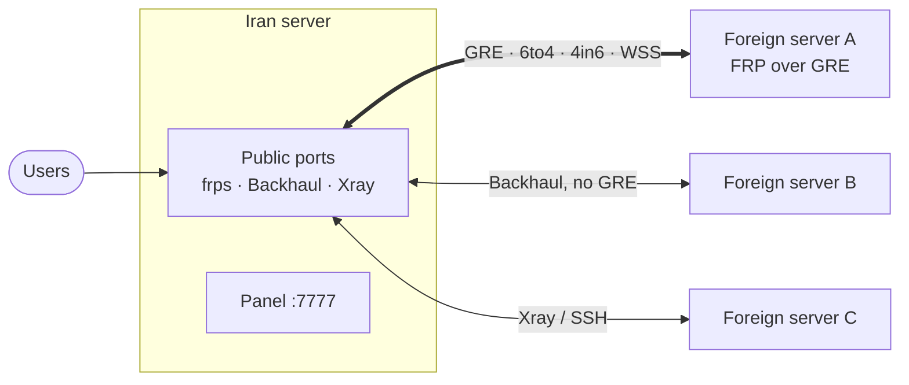

<div align="center">

# Hashem Panel

**Tunnels between an Iran server and foreign servers, managed from one web panel.**

Users connect to the Iran server's public IP; their traffic reaches services on your foreign servers through GRE, FRP, Backhaul, Xray, SSH or a spoofed pipe, with health checks, failover and safe updates built in.

[](https://github.com/pdnczone/hashem-panel/releases/latest)
[](https://github.com/pdnczone/hashem-panel/actions/workflows/ci.yml)
[](#requirements)
[](LICENSE)

English · [فارسی](README.fa.md) · [Website](https://pdnczone.ir) · [Telegram](https://t.me/pdnczone) · [YouTube](https://youtube.com/@pdnczone)


</div>

## What's new in v2.7.0

- **IPv6 in every tunnel.** Users connect over IPv4 and IPv6 at once, and the two servers can link over IPv6. Limits, counters, the path test and cluster DNS (AAAA) included. [Guide](docs/IPV6.md)
- **6to4 and 4in6 GRE wraps,** for networks that drop protocol 47 but pass 41, or that only work over IPv6. Both servers switch together and go back if the tunnel stays silent.
- **Xray tunnel** (Reality, XHTTP, gRPC, mKCP; direct, reverse or through Cloudflare), next to 3x-ui or Marzban without touching them. [Guide](docs/XRAY_TUNNEL.md)
- **Speed and volume limits** per foreign server, **faster Bagher** with several foreign servers, and **accurate traffic counters.**

Every change, with upgrade notes: [CHANGELOG](CHANGELOG.md).

## How it works



The **Iran server** owns the public ports users connect to. Each **foreign server** runs your services (for example an Xray panel) and is linked to the Iran server by a tunnel. The same panel runs on both sides: you set up the Iran server, copy one **setup bundle**, and paste it on the foreign server.

## Tunnels

| Tunnel | How it travels | Pick it when |
| --- | --- | --- |
| **GRE + FRP** | FRP over a GRE link (tcp, kcp, quic, websocket, wss) | the default: most options, free |
| **Backhaul** | with or without GRE (tcpmux, ws, wss, udp, …) | GRE is blocked, or you want Backhaul's transports |
| **Xray** | VLESS with Reality, XHTTP, gRPC, mKCP or a CDN | the path needs to look like normal HTTPS |
| **Bagher** | FRP inside a pool of SSH connections | only SSH gets through |
| **Spoof** | spoofed-source pipe with WireGuard on top | the firewall whitelists source IPs |

The GRE link itself can be wrapped four ways: **Direct** (protocol 47), **WSS** (TLS on a web port), **6to4** (protocol 41) and **4in6** (over IPv6). Not sure what gets through? **Path test** (Benchmark tab) checks every transport between your two servers before you build anything. Details: [docs/ENGINES.md](docs/ENGINES.md).

## Features

- **One health model** for the dashboard, the map and every card, with latency per link and alerts by webhook or Telegram when a tunnel changes state.
- **Swap a tunnel's carrier** from either server; both switch, and both go back if the new one does not connect within 45 seconds.
- **Cluster:** several foreign servers behind one Iran port (failover, balance, sticky, least connections), Iran servers backing each other up, and DNS failover. [Guide](docs/CLUSTER.md)
- **Watchdog, encrypted backups and diagnostics** (`hashem doctor`), with Quick Repair.
- **Updates you can undo:** stable and dev channels, SHA-256 verified, automatic rollback after a bad start.
- **Hardened panel:** argon2id passwords, CSRF, optional 2FA, audit log; the web terminal is off by default.
- **Everything from SSH too:** `hashem` opens a terminal app with the same menus as the panel.

## Quick install

Run on **both** servers:

```bash
bash <(curl -fsSL https://raw.githubusercontent.com/pdnczone/hashem-panel/main/install.sh)
```

1. **Iran server:** choose `1`, pick the tunnel and ports, and copy the bundle it prints (`hsh1_…`).
2. **Foreign server:** choose `2` and paste the bundle.
3. **Open the panel** at the URL printed at the end (`http://<server-ip>:7777/<secret>`). Lost it? `hashem show-panel-url`; new password: `hashem reset-password`.

More foreign servers are added from the panel's **Setup** tab. To read the installer first, or pin it to a release's `checksums.txt`, see [Installing safely](docs/OPERATIONS.md#installing-safely).

> [!IMPORTANT]
> The panel uses plain HTTP on a long random path by default. Before exposing it, add TLS with `hashem tls issue <domain>` or a reverse proxy ([docs/DEPLOYMENT.md](docs/DEPLOYMENT.md)).

## Requirements

- Linux with systemd, `amd64` or `arm64` (developed on Ubuntu), and root on both servers. The installer adds missing packages.
- The GitHub releases reachable from both servers, for install and updates.
- Between the servers, whatever your tunnel uses:

| Tunnel or wrap | Open |
| --- | --- |
| Direct GRE · 4in6 | IP protocol 47 (over IPv4 · over IPv6) |
| 6to4 | IP protocol 41 |
| WSS wrap | TCP `8443` (default) |
| FRP · Backhaul · Xray | the control port you choose (UDP too for kcp, quic, udp) |
| Panel | TCP `7777`, or `7443` once HTTPS is on |

## Hashem Pro

GRE + FRP, the panel and updates are free. A **Pro license** unlocks Backhaul setup, Xray, Bagher, Spoof, limits, the cluster, the path test, diagnostics, performance tuning, the watchdog and the benchmark. Every Pro key opens every Pro feature, including ones added later, and tunnels and settings that already run keep running without one. [pdnczone.ir](https://pdnczone.ir)

## Documentation

| | |
| --- | --- |
| **Start** | [Choosing a tunnel](docs/ENGINES.md) · [Troubleshooting](docs/TROUBLESHOOTING.md) · [Secure deployment](docs/DEPLOYMENT.md) |
| **Guides** | [IPv6](docs/IPV6.md) · [Xray tunnel](docs/XRAY_TUNNEL.md) · [Cluster](docs/CLUSTER.md) · [Cluster tutorial](docs/CLUSTER_TUTORIAL.md) · [FRP transports](docs/FRP_TUNNELS_GUIDE.md) |
| **Reference** | [Operations: health model, updates, CLI, uninstall](docs/OPERATIONS.md) · [HTTP API](docs/API.md) · [Error codes](docs/ERROR_CODES.md) · [Changelog](CHANGELOG.md) |
| **Project** | [Contributing](CONTRIBUTING.md) · [Development](docs/dev/DEVELOPMENT.md) · [Security policy](SECURITY.md) · [Code of conduct](CODE_OF_CONDUCT.md) |

Persian versions exist for the README and the IPv6, Xray, cluster and FRP guides.

## Contributing and license

Issues and pull requests are welcome; read [CONTRIBUTING.md](CONTRIBUTING.md) and branch from `dev`. Report vulnerabilities privately ([SECURITY.md](SECURITY.md)).

Licensed under the [GNU AGPL-3.0](LICENSE): if you run a modified version as a network service, publish your changes under the same license. The Pro features need a license from the author.
