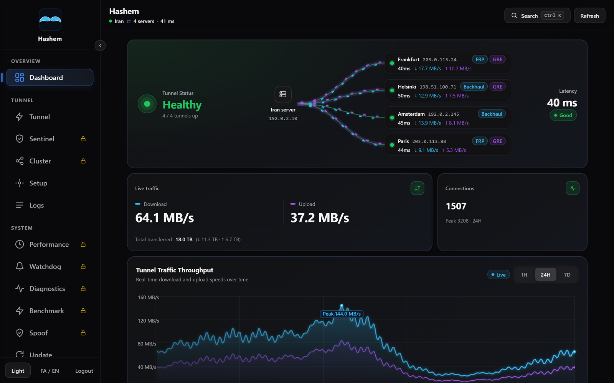
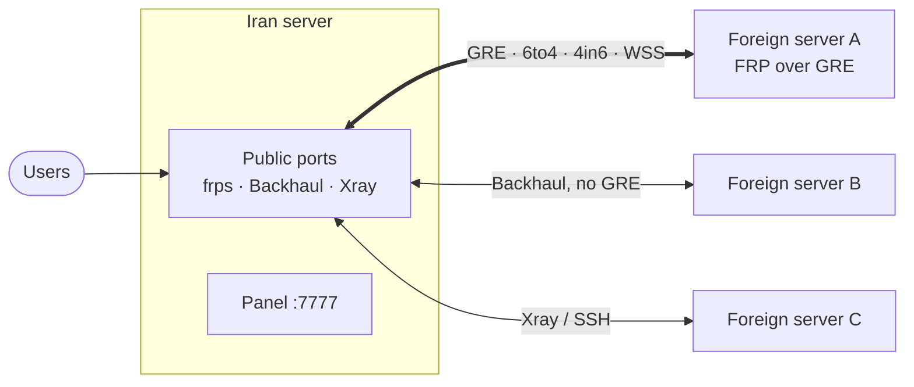

<div align="center">

# Hashem Panel

**Tunnels from an Iran server to your foreign servers — built, watched and repaired from one web panel.**

Users connect to the Iran server's public IP. Their traffic reaches the services on your foreign servers over GRE, FRP, Backhaul, Xray, SSH or a spoofed pipe, with health checks, automatic failover and updates you can undo.

[](https://github.com/pdnczone/hashem-panel/releases/latest)
[](https://github.com/pdnczone/hashem-panel/releases)
[](https://github.com/pdnczone/hashem-panel/actions/workflows/ci.yml)
[](#requirements)
[](LICENSE)

English · [فارسی](README.fa.md) · [Website](https://pdnczone.ir) · [Telegram](https://t.me/pdnczone) · [YouTube](https://youtube.com/@pdnczone)



[Quick start](#quick-start) · [Tunnels](#tunnel-engines) · [Features](#features) · [What's new](#whats-new-in-v312) · [CLI](#command-line) · [Docs](#documentation)

</div>

---

## Why Hashem

- **One install, both sides.** The same panel runs on the Iran server and on every foreign server. Set up the Iran side, copy one setup bundle, paste it on the foreign side.
- **Every way through.** Six tunnel engines and four GRE wraps, plus a path test that tells you which ones get through *before* you build anything.
- **It keeps itself up.** Health checks on every link, carrier swaps that undo themselves when they fail, a Watchdog, and Autopilot moving a dead tunnel to a carrier that works.
- **Many servers, one place.** A central panel manages all your servers; a node needs only a small core, not a whole panel.

## How it works



The **Iran server** owns the public ports users connect to. Each **foreign server** runs your services (an Xray panel, for example) and is linked to the Iran server by a tunnel. Add more foreign servers from the **Setup** tab, or put several behind one port with the cluster.

## Tunnel engines

| Engine | How it travels | Pick it when |
| --- | --- | --- |
| **GRE + FRP** | FRP over a GRE link (tcp, kcp, quic, websocket, wss) | The default: the most options, and free |
| **Backhaul** | With or without GRE (tcpmux, ws, wss, udp, …) | GRE is blocked, or you want Backhaul's transports |
| **Xray** | VLESS with Reality, XHTTP, gRPC, mKCP or a CDN | The path has to look like ordinary HTTPS |
| **Bagher** | FRP inside a pool of SSH connections | Only SSH gets through |
| **Spoof** | A spoofed-source pipe with WireGuard on top | The firewall only lets whitelisted source IPs in |

The GRE link itself can travel four ways: **Direct** (protocol 47), **WSS** (TLS on a web port), **6to4** (protocol 41) and **4in6** (over IPv6). Not sure what gets through? The **path test** checks every transport between two servers before you commit to one. Details: [Choosing a tunnel](docs/ENGINES.md).

## Features

**Reliability**
- **One health model** for the dashboard, the header, the Nodes map and every card, with each link's latency, and alerts by webhook or Telegram when a tunnel changes state.
- **Carrier swap** from either server: both ends switch together, and both go back if the new carrier does not connect within 45 seconds.
- **Autopilot** (Pro): a tunnel that stays down is path-tested and moved to the fastest carrier that gets through, on both servers, within the limits you set. [Guide](docs/AUTOPILOT.md)
- **Watchdog** that restarts only what is really broken, and leaves working tunnels alone.

**Many servers**
- **Nodes:** add a server with one line or over SSH, open any server's pages from the central, build a tunnel between two servers from one page, and update, back up and get alerts for all of them in one place. [Guide](docs/NODES.md)
- **Node core:** a node can run `hashem-node`, the same program without the web page; switch a server between core and full panel at any time.
- **Nodes map:** every server in its column, tunnels drawn as lines in their health color, with each tunnel's carrier and live CPU, RAM, disk and traffic.
- **Cluster:** several foreign servers behind one Iran port (failover, balance, sticky, lowest latency, least connections), Iran servers backing each other up, a foreign server serving several Iran hubs, and DNS failover. [Guide](docs/CLUSTER.md)

**Insight**
- **Path test and Benchmark:** every transport and carrier measured and scored, with the best one applied in a click; also between any two servers from the Nodes page.
- **Diagnostics** (Pro): reachability that tells a filtered port from a filtered IP, clock drift between the servers, a hop-by-hop route, a stability test with a chart, every forwarded port tested, and a scheduled history.
- **Customers** (Pro): sell tunnels with plans by days, volume and speed; a customer's tunnels stop when the plan ends. [Guide](docs/CUSTOMERS.md)

**Operations and security**
- **Updates you can undo:** stable and dev channels, SHA-256 verified downloads, automatic rollback after a bad start, and FRP moved to the pinned version on update.
- **Encrypted backups**, performance tuning sized to the server's RAM, and Quick Repair.
- **A hardened panel:** argon2id passwords, CSRF protection, optional 2FA, an audit log, and a web terminal that is off by default.
- **Everything from SSH too:** `hashem` opens a terminal app with the same menus as the panel.

## What's new in v3.1.2

- **Node core and the Nodes map:** nodes no longer need a full panel, and the Nodes page draws your whole network with live health.
- **Test between servers:** path test and tunnel benchmark between any two servers, with no code to copy.
- **Autopilot tab:** a tunnel that stays down moves itself to a carrier that gets through.
- **Deeper Diagnostics:** reachability, clocks, route, stability, ports and history.
- **FRP upgrades with Hashem:** `hashem update` now moves an older FRP to the pinned 0.71.0, checking every config first and rolling back if a service does not come up.
- **Fixes from a busy hub** (20k+ connections): logs no longer fill the disk, frps/frpc get a memory limit, and the Watchdog leaves working tunnels alone.
- **Cluster:** a foreign server can join a second Iran hub over FRP ([#14](https://github.com/pdnczone/hashem-panel/issues/14)).
- A redesigned panel: header, Settings, Update, Performance and Benchmark pages.

Full list: [CHANGELOG.md](CHANGELOG.md).

## Quick start

Run on **both** servers:

```bash
bash <(curl -fsSL https://raw.githubusercontent.com/pdnczone/hashem-panel/main/install.sh)
```

1. **Iran server:** choose `1`, pick the tunnel and the ports, and copy the bundle it prints (`hsh1_…`).
2. **Foreign server:** choose `2` and paste the bundle.
3. **Open the panel** at the address printed at the end (`http://<server-ip>:7777/<secret>`).

Lost the address? `hashem show-panel-url`. New password: `hashem reset-password`. Already have a central panel? Its **Nodes** page gives one line that installs the node core on a new server and joins it. To read the installer first, or pin it to a release's `checksums.txt`, see [Installing safely](docs/OPERATIONS.md#installing-safely).

> [!IMPORTANT]
> By default the panel serves plain HTTP on a long random path. Before exposing it, add TLS with `hashem tls issue <domain>` or put it behind a reverse proxy ([Secure deployment](docs/DEPLOYMENT.md)).

## Command line

| Command | What it does |
| --- | --- |
| `hashem` | The terminal app, with the same menus as the panel |
| `hashem status` · `hashem logs` · `hashem restart` | Tunnel state, logs, restart |
| `hashem doctor [fix]` | Latency, jitter, MTU and speed checks; `fix` runs Quick Repair |
| `hashem carrier status\|next` · `hashem autopilot on\|off` | Carrier failover and Autopilot |
| `hashem update` · `hashem update-channel stable\|dev` | Update the script, the panel and FRP |
| `hashem backup now` · `hashem backup restore <file>` | Encrypted backups |
| `hashem tls issue <domain>` · `hashem settings` | HTTPS and panel settings |
| `hashem node-join <code>` · `hashem panel status\|install\|remove` | Join a central; switch between node core and panel |
| `hashem join-hub --bundle …` · `hashem cluster status` | Cluster: serve several Iran hubs, pools |

`hashem --help` lists every command. Reference: [Operations](docs/OPERATIONS.md).

## Requirements

- Linux with systemd on `amd64` or `arm64` (developed on Ubuntu), and root on both servers. The installer adds missing packages.
- Both servers can reach GitHub releases, for install and updates.
- Between the servers, open whatever your tunnel uses:

| Tunnel or wrap | Open |
| --- | --- |
| Direct GRE · 4in6 | IP protocol 47 (over IPv4 · over IPv6) |
| 6to4 | IP protocol 41 |
| WSS wrap | TCP `8443` (default) |
| FRP · Backhaul · Xray | The control port you choose (UDP too for kcp, quic and udp) |
| Panel | TCP `7777`, or `7443` once HTTPS is on |

## Hashem Pro

GRE + FRP, the panel and updates are free. A **Pro license** unlocks Backhaul setup, Xray, Bagher, Spoof, limits, the cluster, Autopilot, the path test, diagnostics, performance tuning, the Watchdog and the benchmark. Every Pro key opens every Pro feature, including ones added later, and tunnels and settings that already run keep running without one. Get a license at [pdnczone.ir](https://pdnczone.ir).

## Documentation

| | |
| --- | --- |
| **Start** | [Choosing a tunnel](docs/ENGINES.md) · [Troubleshooting](docs/TROUBLESHOOTING.md) · [Secure deployment](docs/DEPLOYMENT.md) |
| **Guides** | [Nodes](docs/NODES.md) · [Autopilot](docs/AUTOPILOT.md) · [Cluster](docs/CLUSTER.md) · [Cluster tutorial](docs/CLUSTER_TUTORIAL.md) · [Customers](docs/CUSTOMERS.md) · [Xray tunnel](docs/XRAY_TUNNEL.md) · [IPv6](docs/IPV6.md) · [FRP transports](docs/FRP_TUNNELS_GUIDE.md) |
| **Reference** | [Operations: health model, updates, CLI, uninstall](docs/OPERATIONS.md) · [HTTP API](docs/API.md) · [Error codes](docs/ERROR_CODES.md) · [Changelog](CHANGELOG.md) |
| **Project** | [Contributing](CONTRIBUTING.md) · [Development](docs/dev/DEVELOPMENT.md) · [Security policy](SECURITY.md) · [Code of conduct](CODE_OF_CONDUCT.md) |

Persian versions exist for this README and for the Nodes, Autopilot, cluster, customers, IPv6, Xray and operations guides.

## Contributing and license

Issues and pull requests are welcome: read [CONTRIBUTING.md](CONTRIBUTING.md) and branch from `dev`. Report vulnerabilities privately ([SECURITY.md](SECURITY.md)).

Hashem is made by **[pdnczone](https://github.com/pdnczone)** and licensed under the [GNU AGPL-3.0](LICENSE): if you run a modified version as a network service, publish your changes under the same license. The Pro features need a license from the author.
